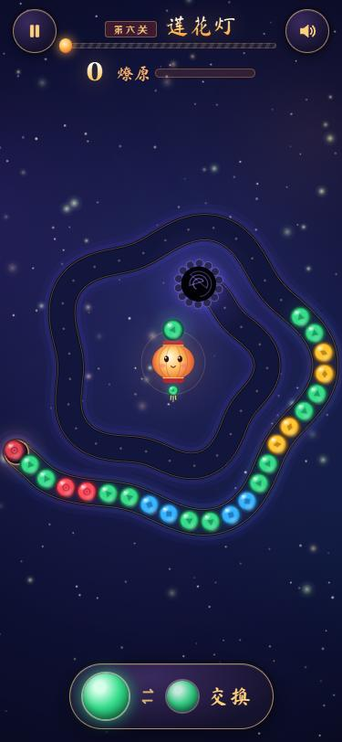
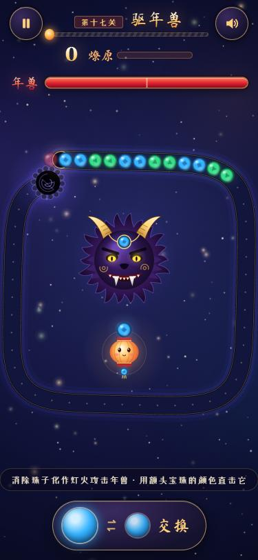

<div align="center">

# 萤灯连珠

**一夜灯会 · 连珠成火**

一款以「灯会 · 萤火」为主题的原创轨道珠链三消网页游戏。<br>
提灯精灵「灯灵」守在灯会中央，把彩珠射进蜿蜒而来的珠串，三珠同色即消，别让它们落进古井。

纯静态网页 · 零外网依赖 · 电脑与手机触屏都能玩

### [▶ 在线试玩](https://hbycrj.com/games/zuma/) &nbsp;·&nbsp; [🎮 翼程游戏大厅](https://hbycrj.com/games/)

作者：[清河县翼程软件开发](https://hbycrj.com) · [hbycrj.com](https://hbycrj.com)

<a href="https://hbycrj.com/games/zuma/"></a> &nbsp;
<a href="https://hbycrj.com/games/zuma/"></a> &nbsp;
<a href="https://hbycrj.com/games/zuma/"></a>

</div>

## 在线试玩

打开 **<https://hbycrj.com/games/zuma/>** 即可直接游玩，电脑和手机浏览器都支持，无需下载安装。更多游戏见 **[翼程游戏大厅](https://hbycrj.com/games/)**。

## 玩法

- 把灯灵手上的珠子射进珠串，凑成 **三颗及以上同色** 即可消除
- 消除后断口两侧如果同色，后段会 **回吸** 合拢，形成连锁
- 珠串一直向古井推进，任何一条珠串落井即失败
- 每次消除都会积攒 **「燎原」**（Fever），攒满后获得 6 发 **火珠**：不用凑色，打到哪炸到哪
- 把一整条珠串打空会触发 **「一扫而空」** 奖励；清空后新珠会立刻冲进来，不用干等
- 按得分与表现评 1～3 星

### 操作

| | 电脑 | 手机 |
|---|---|---|
| 瞄准 | 移动鼠标 | 按住屏幕拖动 |
| 发射 | 左键 | 松手 |
| 交换手上 / 下一颗珠 | 右键 或 空格 | 点底部珠盘，或轻点灯灵 |
| 暂停 | Esc / P | 左上角按钮 |

### 道具珠

珠串上会随机出现带图标的道具珠，消除它即可触发：

| 道具 | 效果 |
|---|---|
| 炸裂 | 炸掉周围一圈珠子 |
| 雷光 | 消除场上所有同色珠 |
| 缓行 | 珠串一段时间内减速 |
| 倒流 | 珠串短暂后退 |
| 彩珠 | 下一发变成万能彩珠，可匹配任意颜色 |

### 内容

- **17 个关卡**：螺旋、蛇形、方城、花瓣、星芒等多种轨道，含双轨关卡（两条珠串同时进攻）
- **首领关「驱年兽」**：消除珠子化作灯火攻击年兽，用它额头宝珠的颜色可以直击要害
- **无尽模式「无尽长夜」**：每 35 秒升一重，越来越快，挑战最高分
- **每关三项挑战**：连锁、连击、不用道具、不交换珠子……每关都值得再刷一遍
- **成就「灯谱」**：近 50 枚朱印成就，含隐藏成就，附生涯统计「灯会志」
- **灯坊**：过关、挑战、成就都能赚灯币，用来换玉兔灯、青莲灯、锦鲤灯、紫宸宫灯等灯灵外观；金龙灯、夜明灯只能靠成就点亮

## 本地运行

项目没有构建步骤，任意静态文件服务器都能运行（需要通过 http 访问，直接双击 `index.html` 打不开 ES 模块）：

```bash
npm run dev
# 等同于 python -m http.server 5173 --bind 127.0.0.1
```

然后打开 <http://localhost:5173>。

手机上调试：把服务器绑定到 `0.0.0.0`，手机连同一局域网后访问电脑 IP 即可。

## 打包部署

```bash
npm run build        # 字体子集化 → 关卡校验 → 打包
npm run build:quick  # 跳过字体子集化（只改了代码、没有新增中文时）
```

压缩包里的 `index.html`、`style.css` 和各模块之间的引用会自动加上 `?v=版本号`（按文件内容生成），更新上线后玩家浏览器不会混用新旧缓存。源码本身不受影响。

产物是 `dist/lantern-orbs.zip`（约 450 KB），解压到网站任意目录即可，`index.html` 在压缩包最外层。不依赖任何 CDN 或外网资源，内网也能部署。

> 通过 `/zuma` 这类不带结尾斜杠的地址访问时，页面会自动补上斜杠，避免相对路径资源 404。

### 构建依赖

- Python 3.9+，字体子集化需要 `pip install fonttools`
- Node.js（仅用于关卡校验脚本）

## 开发说明

### 目录结构

```
index.html            页面骨架与 HUD
style.css             全部界面样式（标题页、卷轴弹窗、HUD、触屏适配）
src/
  main.js             入口：界面、关卡选择、结算、存档（localStorage）
  game.js             核心玩法：轨道推进、发射、插入、消除连锁、道具、首领、Fever
  levels.js           关卡数据（1000×1000 世界坐标）与无尽模式难度曲线
  path.js             Catmull-Rom 轨道曲线，按弧长等距采样
  textures.js         运行时用 Canvas 绘制的珠子、灯笼、道具贴图
  fx.js               粒子、闪电、飘字等特效
  audio.js            WebAudio 合成的音效与背景音乐（无音频文件）
  config.js           手感参数及默认值
  devpanel.js         调参面板
lib/pixi.min.js       PixiJS 7.4.2（本地化，不走 CDN）
fonts/                子集化后的字体（只含游戏用到的字）
tools/
  build.py            打包脚本
  subset-fonts.py     字体子集化
  check-levels.mjs    关卡校验
  fontsrc/            原始字体文件（仅开发用，不会打包）
```

### 调参面板

游戏中按 <kbd>`</kbd> 键，或在网址后加 `?dev`，可以打开调参面板，实时调整发射速度、珠串速度、震屏、顿帧、道具频率、Fever 等手感参数。参数只保存在本机浏览器；点「复制参数」可以导出 JSON，再写进 `src/config.js` 作为默认值。

### 新增关卡

在 `src/levels.js` 的 `LEVELS` 里添加一项。轨道可以用控制点数组，也可以用内置的 `spiral` / `squircle` / `flower` 等生成器。双轨关卡用 `tracks: [{ path, count }, ...]`。

添加后运行校验，确保相邻圈不重叠、轨道离灯灵足够远、没有越界：

```bash
npm run check
```

### 新增中文文字

字体是按实际用字子集化的。**新增了界面上的中文**（关卡名、提示语等）之后，要重新生成字体，否则新字会回退成系统字体：

```bash
npm run fonts
```

`npm run build` 会自动执行这一步。

### 手机适配

- 世界坐标固定为 1000×1000，按关卡实际使用的区域等比缩放到屏幕
- 触屏设备上珠子放大约 17%，同时按比例减少珠子数量，保证关卡节奏不变
- 竖屏底部有珠盘按钮用于交换；手机横屏时 HUD 移到左侧
- 支持震动反馈（安卓浏览器）

## 技术栈

- [PixiJS](https://pixijs.com/) 7 —— WebGL 渲染
- 原生 ES Modules，无打包工具、无框架
- 贴图在运行时用 Canvas 2D 绘制，音效用 WebAudio 实时合成，仓库里没有图片或音频素材

## 作者

由 **[清河县翼程软件开发](https://hbycrj.com)** 开发并开源。更多作品见 [翼程游戏大厅](https://hbycrj.com/games/)。

我们承接小程序、App、网站与企业软件定制开发，详见官网 [hbycrj.com](https://hbycrj.com)。

## 许可

本项目源码以 [MIT License](LICENSE) 开源。

### 第三方许可

| 组件 | 许可 |
|---|---|
| [PixiJS](https://github.com/pixijs/pixijs) | MIT |
| [马善政楷书 Ma Shan Zheng](https://fonts.google.com/specimen/Ma+Shan+Zheng) | SIL Open Font License 1.1 |
| [站酷小薇体 ZCOOL XiaoWei](https://fonts.google.com/specimen/ZCOOL+XiaoWei) | SIL Open Font License 1.1 |
| [Cinzel](https://fonts.google.com/specimen/Cinzel) | SIL Open Font License 1.1 |

字体许可证全文见 `fonts/OFL-*.txt`。
